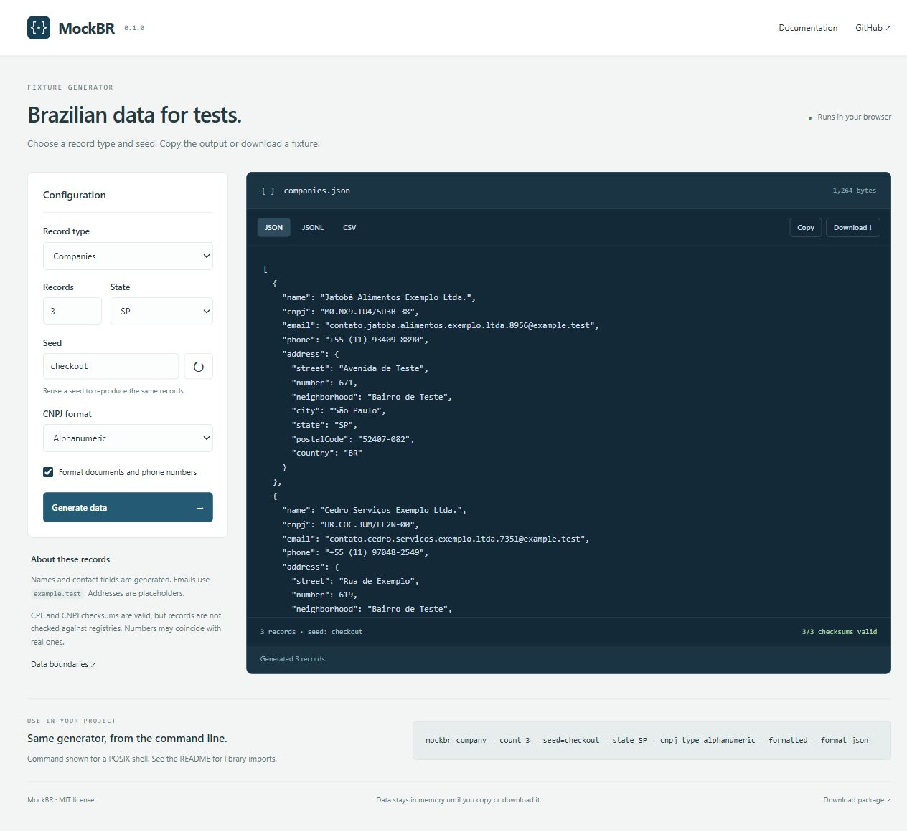

# MockBR

Generate Brazilian test data with a repeatable seed. Use it as a JavaScript library, a command-line tool, or in the [browser demo](https://almeida96.github.io/mockbr/).

People, companies, CPF, CNPJ, addresses, and mobile numbers. No runtime dependencies or network requests. TypeScript declarations are included.



## Install

Requires Node.js 22 or later. Build the package from this checkout with `pnpm install --frozen-lockfile` and `pnpm pack --out mockbr-0.2.0.tgz`, then install the archive:

```sh
npm install ./mockbr-0.2.0.tgz
```

The package is distributed through GitHub Releases; it is not published to the npm registry.

```js
import { createMock, generate } from '@almeida96/mockbr';

const people = generate('person', 20, { seed: 'checkout', state: 'SP' });

const mock = createMock({ seed: 'signup', formatted: true });
const person = mock.person();
const company = mock.company();
const cpfs = mock.many('cpf', 10);
```

## Command line

```sh
npx --no-install mockbr person --count 20 --seed checkout --state SP
npx --no-install mockbr company --cnpj-type numeric --format jsonl --out companies.jsonl
npx --no-install mockbr cpf --formatted --format csv --out cpfs.csv
```

| Option | Default | Meaning |
| --- | --- | --- |
| `--count` | `5` | Number of records, from 0 to 10,000 |
| `--seed` | `mockbr` | Text used to initialize the generator |
| `--state` | Any | Uppercase state code, such as `SP` or `BA` |
| `--cnpj-type` | `alphanumeric` | `alphanumeric` or `numeric` |
| `--formatted` | Off | Punctuation for documents, phones, and postal codes |
| `--format` | `json` | `json`, `jsonl`, or `csv` |
| `--out` | Standard output | Destination file |
| `--force` | Off | Allow replacing an existing output file |

Use `--help` for usage and `--version` for the installed version. Options accept both `--count 10` and `--count=10`. For a seed starting with `--`, use the equals form. Errors go to standard error and return exit code 2. File output does not create missing directories.

## Library API

`createMock(options)` returns a generator with `person()`, `company()`, `cpf()`, `cnpj()`, `address()`, `phone()`, and `many(kind, count = 1)`.

`generate(kind, count = 1, options)` creates a fresh generator and returns an array. Supported kinds are `person`, `company`, `cpf`, `cnpj`, `address`, and `phone`.

| Option | Default | Accepted values |
| --- | --- | --- |
| `seed` | `'mockbr'` | String of 1–128 characters or a safe integer |
| `state` | Any | One of the 27 values in `STATES` |
| `formatted` | `false` | Boolean |
| `cnpjType` | `'alphanumeric'` | `'alphanumeric'` or `'numeric'` |

Each generator has its own random stream. The same version, seed, options, and call order produce the same data. A numeric seed and its string representation are equivalent. Calling a method advances the stream; a new generator starts over. Formatting does not change the underlying values.

The generator uses a 32-bit seeded PRNG. It is not cryptographic, different seeds can collide, and generated values are not guaranteed to be unique. Batch size is limited to 10,000 records per call; zero returns an empty array. The browser demo limits batches to 1,000 records.

### Record fields

| Kind | Fields or value |
| --- | --- |
| `person` | `name`, `cpf`, `email`, `phone`, `address` |
| `company` | `name`, `cnpj`, `email`, `phone`, `address` |
| `address` | `street`, `number`, `neighborhood`, `city`, `state`, `postalCode`, `country` |
| `cpf`, `cnpj`, `phone` | String |

Names and address placeholders use Portuguese words. API field names and documentation are in English.

### CPF and CNPJ helpers

```js
import {
  cpfCheckDigits, cnpjCheckDigits,
  isCPF, isCNPJ, formatCPF, formatCNPJ,
} from '@almeida96/mockbr';

cnpjCheckDigits('12ABC34501DE'); // '35'
isCNPJ('12.ABC.345/01DE-35'); // true
formatCNPJ('12ABC34501DE35'); // '12.ABC.345/01DE-35'
```

Check-digit functions take an unformatted base: 9 digits for CPF or 12 uppercase letters/digits for CNPJ. They return the two check digits. Validators accept raw strings or the exact document mask, reject repeated-digit documents, and return `false` for other input. Formatters require a valid checksum and throw on invalid input. Whitespace and lowercase letters are not normalized.

Alphanumeric CNPJ uses the character's ASCII value minus 48, with the same modulus-11 calculation used by numeric CNPJ. The example above comes from the [Receita Federal FAQ](https://www.gov.br/receitafederal/pt-br/centrais-de-conteudo/publicacoes/perguntas-e-respostas/cnpj/cnpj-alfanumerico.pdf). Generated alphanumeric values always include at least one letter. Numeric generation uses a random eight-digit root and branch `0001`.

### Export formats

```js
import { generate, serialize } from '@almeida96/mockbr';

const rows = generate('person', 10, { seed: 'import-test' });
const csv = serialize(rows, 'csv');
const jsonLines = serialize(rows, 'jsonl');
```

JSON uses two-space indentation. JSON Lines writes one record per line. CSV uses a header, quotes every cell, doubles embedded quotes, and uses CRLF line endings. Nested address fields become columns such as `address.city`; scalar records use a `value` column. Empty JSON output is `[]` followed by a newline; empty JSON Lines and CSV output are empty strings.

CSV preserves values, including leading zeros and the `+` in phone numbers. Spreadsheet programs may interpret these as numbers or formulas even when quoted. Import those columns as text, or use JSON when exact string values matter. CSV serialization supports plain objects with scalar fields; arrays and keys containing dots are rejected.

## Linked shop fixtures

Generate a small database fixture instead of disconnected records:

```sh
node bin/mockbr.js dataset --seed checkout --customers 20 --products 10 --count 50 --out shop.json
```

```js
import { generateDataset } from '@almeida96/mockbr';
const shop = generateDataset({ seed: 'checkout', state: 'SP', customers: 20, products: 10, orders: 50 });
const customer = shop.customers.find(row => row.id === shop.orders[0].customerId);
```

The JSON object contains `version: 1`, `customers`, `products`, and `orders`. Customer IDs, CPFs and test emails are unique within one dataset. Orders reference existing customers and products; each product appears at most once per order. `totalCents` equals the sum of quantity × unit price. All amounts use integer BRL cents, without discounts, shipping or taxes.

Dates are generated within 2025 in UTC, independent of the machine clock. Statuses are `pending`, `paid`, `shipped`, or `cancelled`; they are fixture labels, not a payment workflow. The same version and options reproduce the whole dataset. IDs are local to a dataset and must not be merged across seeds without remapping.

Each collection supports 0–10,000 records. Nonempty orders require at least one customer and product. The CLI defaults to 20 customers, 10 products and 50 orders; `--count` controls orders. Datasets use JSON only because CSV would lose nested order items. In the browser choose **Shop dataset**, then copy or download the same structure.

## Data boundaries

- CPF and CNPJ checks confirm syntax and check digits only. They do not check registration, ownership, or tax status.
- Names are assembled from small word lists. Generated names, documents, and phone numbers can coincide with real ones.
- Emails use `example.test`, under the [reserved `.test` domain](https://www.rfc-editor.org/rfc/rfc2606).
- Addresses use placeholder streets and neighborhoods. Cities are state capitals; each phone's area code matches that capital. This is not a complete Brazilian address database.
- Postal codes have the correct shape but are random. They are not checked against Correios and may not belong to the selected state.

Use the output for fixtures, validation tests, and interface development.

## Development

```sh
pnpm install --frozen-lockfile
pnpm check
pnpm test
pnpm build
pnpm dev
```

Open `http://127.0.0.1:4175`. The demo imports the same modules as the package and keeps its data in memory. To run the CLI from the source checkout:

```sh
node bin/mockbr.js person --count 3 --seed checkout
```

Build and verify the release archive:

```sh
pnpm pack --out mockbr-0.2.0.tgz
pnpm pack:check
```

CI checks JavaScript syntax, TypeScript consumer declarations, the test suite, and the packed archive on Linux, Windows, and macOS. The browser demo deploys to GitHub Pages after those checks pass.

## License

MIT. See [LICENSE](LICENSE).
